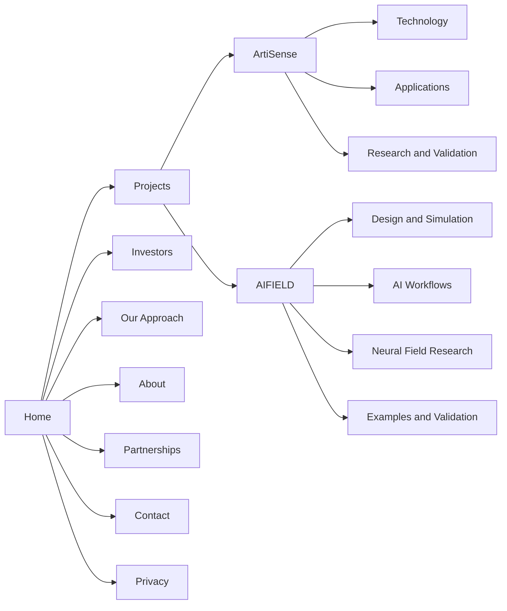

# Artifactory Website Sitemap Draft

Packaged snapshot HP-1.1, 9 October 2026. Links and source availability are adapted for this PDF-free handoff; the underlying planning version is retained. Read the [package boundaries](../README.md#package-boundaries) first.

Version SM-0.3. Updated 9 October 2026. Status: proposed information architecture within the prepared creation inputs. The [project brief](project-brief.md) owns objectives, source permissions, capabilities, and execution policy; the [decision register](decision-register.md) owns consequential choices and dependencies.

Handoff instruction, 9 October 2026: retain this prepared sitemap in the [gathered package](../README.md). The user has stopped at input gathering; this document is not an instruction to start the next stage. Research PDFs are excluded from the package.

The website should help an investor understand Artifactory, assess its two launch projects, and start a relevant conversation. Partners are the secondary audience. The expanded proposal has seventeen pages in each language: ten core pages and seven project detail pages. Project overviews introduce the opportunity and current stage; their subpages explain technology, applications, workflows, and evidence.

## Confirmed Scope

The user has confirmed the following requirements:

- Prioritize investors, with partners secondary.
- Feature ArtiSense and AIFIELD at launch; defer other research.
- Support English and Polish, with English as the default.
- Provide meaningful project detail through subpages.
- Present the investment opportunity as Artifactory as a company.
- Provide a contact form plus public email.
- Use autonomous evaluation and execution of the complete implementation package within the agreed scope, as defined in the brief's [EP-1.0 policy](project-brief.md#execution-policy).

The exact expanded page set, navigation labels, URLs, detailed form behavior, and publication rules below are proposals. This is a preparation input under the website creation guidelines, not an approved implementation package. The supplied palette selection is recorded in the brief; remaining design and technical choices follow its decision register.

## Proposed Page Hierarchy

The hierarchy is identical in both languages. ArtiSense and AIFIELD are overview pages under Projects, each with dedicated detail pages. Company pages sit directly below the language root. Privacy is a footer destination.

Projects gives visitors a concise comparison. Each project overview offers a complete introduction for a nonspecialist; its subpages answer distinct deeper questions. Investors explains the company-level opportunity. Our Approach describes the shared development and validation method. About identifies the company and people. These boundaries prevent the same story being repeated across several pages.

The two project branches need not be symmetrical. ArtiSense is organized around the sensing system, intended applications, and validation work. AIFIELD separates its design tools, AI workflows, neural field research, and worked examples. Keep development milestones within the relevant overview and evidence pages rather than creating thin standalone roadmap pages.

## Canonical Route Register

Page IDs remain stable when labels or translations change. Each ID represents one purpose with two language variants. Proposed canonical origin: `https://artifactory.tech`. All thirty-four routes below are public and indexable once their content is ready. The seven detail pages are part of the proposed target scope; an unfinished page stays out of public navigation and the generated sitemap.

| Page ID | English label | English route | Polish label | Polish route |
| --- | --- | --- | --- | --- |
| home | Home | `/en/` | Strona główna | `/pl/` |
| projects | Projects | `/en/projects/` | Projekty | `/pl/projekty/` |
| artisense | ArtiSense | `/en/projects/artisense/` | ArtiSense | `/pl/projekty/artisense/` |
| artisense-technology | Technology | `/en/projects/artisense/technology/` | Technologia | `/pl/projekty/artisense/technologia/` |
| artisense-applications | Applications | `/en/projects/artisense/applications/` | Zastosowania | `/pl/projekty/artisense/zastosowania/` |
| artisense-validation | Research and Validation | `/en/projects/artisense/research-validation/` | Badania i walidacja | `/pl/projekty/artisense/badania-walidacja/` |
| aifield | AIFIELD | `/en/projects/aifield/` | AIFIELD | `/pl/projekty/aifield/` |
| aifield-design | Design and Simulation | `/en/projects/aifield/design-simulation/` | Projektowanie i symulacja | `/pl/projekty/aifield/projektowanie-symulacja/` |
| aifield-ai | AI Workflows | `/en/projects/aifield/ai-workflows/` | Praca z AI | `/pl/projekty/aifield/praca-z-ai/` |
| aifield-neural | Neural Field Research | `/en/projects/aifield/neural-field-research/` | Badania neuronowych modeli pola | `/pl/projekty/aifield/badania-modeli-pola/` |
| aifield-validation | Examples and Validation | `/en/projects/aifield/examples-validation/` | Przykłady i walidacja | `/pl/projekty/aifield/przyklady-walidacja/` |
| investors | Investors | `/en/investors/` | Dla inwestorów | `/pl/inwestorzy/` |
| approach | Our Approach | `/en/approach/` | Jak pracujemy | `/pl/jak-pracujemy/` |
| about | About | `/en/about/` | O nas | `/pl/o-nas/` |
| partnerships | Partnerships | `/en/partnerships/` | Współpraca | `/pl/wspolpraca/` |
| contact | Contact | `/en/contact/` | Kontakt | `/pl/kontakt/` |
| privacy | Privacy | `/en/privacy/` | Polityka prywatności | `/pl/prywatnosc/` |

The unprefixed root `/` redirects to `/en/`; it is not an additional content page. This changes the current Polish homepage entry and needs an explicit migration decision. URLs use lowercase ASCII slugs and trailing slashes; visible Polish text retains its diacritics. Brand spellings remain ArtiSense and AIFIELD in both languages.

## Navigation and Visitor Journeys

**Desktop header:** logo linking to the current-language Home, Projects, Investors, Our Approach, About, a primary investment contact action, and English / Polski controls. The Projects menu includes All projects, ArtiSense, and AIFIELD; the index remains a navigable page.

**Mobile navigation:** exposes the same destinations and actions without hover. Include Partnerships and Contact as utility links. The language control switches to the equivalent page and remains easy to find.

**Project navigation:** every overview and child page shows its project name, Overview, and links to the published sibling pages. Use Overview / Przegląd for the existing project root, not a separate `/overview/` URL. The global Projects menu stays focused on All projects, ArtiSense, and AIFIELD; detail pages belong in the project navigation. On mobile, use an accessible expandable list that identifies the current page.

**Footer:** links to the ten core pages, groups the two project overviews together, and includes verified company/contact details and Privacy. Project overviews and local navigation expose all seven detail pages. Partnerships also has prominent contextual links on Home and both project overviews, so partners have a visible route before reaching the footer.

Use breadcrumbs on interior pages. A detail-page breadcrumb is Home > Projects > ArtiSense > Technology, with every ancestor linked. Local section navigation helps readers reach evidence and milestones within longer pages. Cards and calls to action use descriptive labels rather than repeated "Learn more" links. Every child page has a brief project introduction for visitors arriving directly from search or a shared link.

| Entry and intent | Suggested journey | Successful outcome |
| --- | --- | --- |
| Investor arriving at Home | Home > Investors > project overview > relevant evidence page > Contact | An investment enquiry with useful context |
| Investor checking a shared project link | Project detail > overview or Investors > About > Contact | Confidence about progress, team, and next steps |
| Technical partner | Project technology or workflow page > validation > Partnerships > Contact | A proposal tied to a specific collaboration need |
| AIFIELD demo interest | AIFIELD > Design and Simulation > Examples and Validation > Contact | A request that reaches the responsible person |
| Returning visitor | Direct page > language equivalent or current evidence section | Finds the same subject and its current status |

These journeys are options, not mandatory steps. Readers can contact Artifactory from any page.

| Action | English label | Polish label | Destination |
| --- | --- | --- | --- |
| Primary investment enquiry | Discuss an investment | Porozmawiajmy o inwestycji | Contact, investment intent |
| Investor overview | Explore the investment case | Poznaj potencjał inwestycyjny | Investors |
| Partnership enquiry | Discuss a partnership | Porozmawiajmy o współpracy | Contact, partnership intent |
| AIFIELD demonstration | Request a demo | Poproś o demo | Contact, AIFIELD demo intent |

## Page Content Requirements

Each page needs an approved owner, localized title and description, reviewed copy, and rights-cleared assets before publication. Proposed owner roles are listed later; named owners are not yet assigned. Sources refer to the register at the end.

### Home

**Purpose:** explain what Artifactory is and why an investor should investigate further.

Recommended order: company proposition; the problems being pursued; ArtiSense and AIFIELD summaries; their relationship; selected evidence and current stages; team credibility; investment and partnership routes. Present a readable company thesis before specialist terminology.

Show a short, dated status for each project and link to the supporting detail. Proposed framing connects sensing hardware with photonic design tools, but the company must approve that positioning and any statements about ownership or shared intellectual property.

**Onward paths:** Investors is the main content action; Projects, About, and Partnerships provide supporting routes. **Inputs:** approved proposition, two concise project summaries, one or more substantiated proof points, and an authorized visual for each project. Sources: S1, S2, S3.

### Projects

**Purpose:** help readers distinguish the two projects and choose where to go next.

Compare each project's problem, intended users, output, present stage, strongest available evidence, and next validation milestone. Explain the relationship without implying that progress in one validates the other. The index should remain short; link to the project overviews and one relevant evidence page per project rather than repeating their detail.

**Onward paths:** ArtiSense, AIFIELD, Investors. **Inputs:** approved comparable summaries and project stages. Sources: S1, S2, S3. No portfolio filters, search, or empty categories are needed for two projects.

### ArtiSense

**Purpose:** introduce the sensing proposition and help an investor choose which detail to explore.

Recommended sections: intended problem and users; system at a glance; current stage and strongest available evidence; principal limitation; next development milestone; links to the three detail pages; investment and collaboration actions. Keep the overview understandable without requiring a technical detour.

The existing module page describes photonic sensing and a proposed analog neuromorphic processor. Keep that processor distinct from AIFIELD's research neural field solver. Label concept renders and proposed capabilities clearly. A design or simulated result must not become a claim of working glucose measurement or clinical performance. The current homepage and the supplied PDFs differ in the strength of their health-related claims; reconcile these before writing public promises.

**Onward paths:** all three ArtiSense subpages, Investors, Partnerships, Contact, and AIFIELD where the design-tool relationship is relevant. **Inputs:** agreed sensing scope, approved architecture summary, actual validation status, next experiment, and labeled visuals. Sources: S1 pp. 20-50; S2 pp. 7-8, 33; S3 module and homepage. There is no purchase or medical-use action at launch.

#### ArtiSense Technology

**Reader question:** how is the proposed sensing system intended to work?

Explain the path from illumination and interaction with a sample through optical response, detection, processing, and interpretation. Cover photonic components, the proposed signal-processing architecture, calibration assumptions, and integration constraints at the level the team can substantiate. Place photonics and electronics in sections of this page; they do not yet need separate URLs.

**Content to prepare:** a labeled system diagram, a short explanation of each block, present-versus-proposed component status, integration assumptions, and an approved explanation of any AIFIELD contribution. Keep unresolved architecture choices visible rather than presenting a finalized device.

**Onward paths:** Research and Validation for evidence, Applications for intended contexts, Partnerships for collaboration. **Sources:** S3 module; S1 pp. 21-50; S2 p. 33. This page owns the system explanation; other pages use brief summaries and links.

#### ArtiSense Applications

**Reader question:** which problems and users is Artifactory targeting with this system?

Describe approved target applications, the needs they address, the proposed measurement context or form factor, and the evidence each would require. Give glucose sensing a substantive section if confirmed as the priority. Treat wearable images as concepts when that is their status; an intended application does not establish achieved accuracy, clinical readiness, or availability.

**Content to prepare:** target-user descriptions, one substantial application narrative, relevant concept visuals, operating requirements, and a clear account of the gaps between the current work and the intended use. Other chemical-sensing applications appear only if the team approves a specific rationale; do not fill the page with speculative markets.

**Onward paths:** Technology, Research and Validation, Partnerships. **Sources:** S1 pp. 20-50; S2 p. 33; approved scope from S3 reconciled with the project lead. Keep application details together until an individual application has enough evidence and content to justify its own page.

#### ArtiSense Research and Validation

**Reader question:** what has been investigated, what does the evidence establish, and what must happen next?

Present dated design and simulation work, any subsequently confirmed experiments, known constraints, unresolved hypotheses, and the next validation steps. Distinguish optical feasibility, chip design, fabricated-device testing, and any eventual human-use validation. Show a compact development sequence with dependencies and evidence required to advance; dates remain proposals until confirmed.

**Content to prepare:** approved result summaries with methods and conditions, annotated figures, limitations, present maturity, and owners for the next experiments. This page can document research in progress, but needs substantive current work rather than a roadmap alone.

**Onward paths:** Technology, Investors, Partnerships, Contact. **Sources:** S1 pp. 20-50, 74-78; S2 p. 33, plus current project confirmation. This page owns the full ArtiSense evidence record and validation plan; the overview and Investors summarize it.

### AIFIELD

**Purpose:** introduce the photonic engineering tool, its users, and its current stage before readers explore a specialist topic.

Recommended sections: intended users and problem; workflow at a glance; demonstrated capability summary; research status; selected example linked to its evidence; current access and next milestones; links to the four detail pages; demo and investment actions.

Treat the September 2026 deck as a dated snapshot. Separate simulation comparisons from fabricated-device measurements, and demonstrated functions from roadmap items. If benchmark figures are published, include their scope, comparison basis, misses, and date. Research results must retain their boundary conditions and unresolved limitations. Confirm what can actually be shown in a demo before advertising it.

**Onward paths:** all four AIFIELD subpages, Contact for a demo, Investors, Partnerships, and ArtiSense as a relevant application. **Inputs:** current capability summary, approved visual, evidence summary, access model, and roadmap. Sources: S1 pp. 4-20, 51-78; S2 pp. 8, 35, 73. Pricing, checkout, and a documentation portal are outside launch scope.

#### AIFIELD Design and Simulation

**Reader question:** what can an engineer design and simulate with AIFIELD today?

Explain the supported design workflow, geometry and layer/process handling, available classical solvers, inputs, outputs, and current constraints. Organize by engineering task and illustrate a coherent sequence from design setup to results. Separate demonstrated functionality from planned support.

**Content to prepare:** a reviewed capability matrix, real interface images, an example walkthrough, supported input/output details, and solver limitations. Each performance or accuracy claim links to Examples and Validation. A complete user manual is a later capability, not a prerequisite for this explanatory page.

**Onward paths:** Examples and Validation, AI Workflows, Contact for a demo. **Sources:** S1 pp. 4-19. This page owns the CAD and classical-solver capability detail.

#### AIFIELD AI Workflows

**Reader question:** where can AI assist the engineering workflow, and where does a person remain responsible?

Explain the proposed or demonstrated command-line and Model Context Protocol (MCP) interactions through a concrete example: user instruction, agent proposal, human review, tool execution, and inspection of results. Label each step by its actual status. Explain what runs locally, which parts use external services, and what information crosses those boundaries before making any confidentiality claims.

**Content to prepare:** a verified workflow recording or transcript, the available actions, approval and application boundaries, failure/limitation examples, and a reviewed data-flow diagram. Do not imply autonomous end-to-end chip design when the evidence demonstrates partial assistance.

**Onward paths:** Design and Simulation, Examples and Validation, Contact for a demo. **Sources:** S1 pp. 51-60, 74-78. This page owns workflow automation; the separate neural research page owns field prediction.

#### AIFIELD Neural Field Research

**Reader question:** what is the research ambition, and what is still unresolved?

Introduce neural prediction of optical fields, its potential role in the tool, the experiments completed, required inputs, and current research questions. Keep supplied boundary conditions, generalization limits, stitching challenges, and any unresolved speed comparison attached to the relevant results. Explain the relationship to the classical design workflow without presenting the research engine as a prerequisite for every usable capability.

**Content to prepare:** a readable concept diagram, approved research figures, experiment conditions, comparison methods, limitations, and the next research milestones. Clearly identify the page as research in both languages.

**Onward paths:** Design and Simulation, Examples and Validation, Investors, Partnerships. **Sources:** S1 pp. 61-65, 76. This page owns neural-research methods and detailed results; the validation page provides a concise evidence summary and links here.

#### AIFIELD Examples and Validation

**Reader question:** what concrete outputs and comparisons support the project's claims?

Present selected worked designs, the problem and workflow behind each, and their outputs. Include the photonic glucose design example where approved, with a link to ArtiSense for the sensing proposition. Explain benchmark methods, reference tools, tested conditions, successes and misses, and the difference between simulation comparisons and measurements on fabricated devices.

**Content to prepare:** authorized design examples, annotated outputs, a dated benchmark table with its scope and limitations, result provenance, and the next validation milestone. Explain the engineering contribution of each example without relabeling internal work as an external customer case study.

**Onward paths:** Design and Simulation, Neural Field Research, ArtiSense Research and Validation, Investors, Contact for a demo. **Sources:** S1 pp. 4-20, 74-78; S2 pp. 35, 73 after reconciliation. This page owns classical-solver benchmarks and worked examples; neural experiment detail remains on Neural Field Research.

### Investors

**Purpose:** connect Artifactory's proposition, evidence, team, and next milestones to a credible investment conversation.

Recommended sections: company investment rationale; opportunity and intended customers; role and stage of each project; approved differentiation and defensibility; commercial path; milestones and capital use; major unresolved questions; team; request for materials or a conversation.

The user has confirmed Artifactory as a company as the investment opportunity. Explain how both projects support that company-level case. Current funding figures and the public/private information boundary remain to be defined in [DEC-011](decision-register.md#dec-011). The September AIFIELD deck's 750,000 PLN proposal over twelve months is historical project-level source material, not confirmation of the company's current raise. Do not combine project budgets or imply revenue, committed pilots, ownership, or market validation without supporting information.

Link directly to ArtiSense Research and Validation, AIFIELD Examples and Validation, and Neural Field Research where relevant, while keeping the company-level investment story here. Publicly share only approved materials; the uploaded PDFs are research inputs, not authorized downloads.

**Onward paths:** Contact with investment intent, both projects, About. **Inputs:** current company funding details, public/private information boundary, approved milestones and capital use, commercial assumptions, and materials-sharing owner. Sources: S1 pp. 1, 66-78; S2 pp. 7-8, 73; company scope confirmed by S9.

### Our Approach

**Purpose:** explain how Artifactory develops and validates its projects.

Describe the actual process from problem definition through modeling, design, prototype work, and measurement. Explain how the team distinguishes concepts, simulations, prototypes, and independently validated results, and how evidence changes the next milestone. Include one approved example linked to its project page.

This page owns the shared method, not another list of product capabilities. It is justified only if the team can provide a concrete account of its working process. If it cannot, merge the useful material into About and remove this route before implementation.

**Onward paths:** both project overviews, their relevant evidence pages, and Partnerships. **Inputs:** agreed process, validation practices, and one publishable example. Sources: S1 workflow/evidence sections and S2 project notes, supplemented by team confirmation.

### About

**Purpose:** identify the company, explain its focus, and establish the team's relevance.

Recommended sections: Artifactory's purpose and background; team members and relevant experience; role of the two projects; company identity; contact route. Keep team biographies on this page at launch. Distinguish company roles from project leadership; an AIFIELD founder description does not establish the whole company's founder structure.

**Onward paths:** Investors, Our Approach, Partnerships, Contact. **Inputs:** current roster and roles, approved biographies/photos, company history, and verified legal details. Sources: S3 About and Contact, with S1 p. 70 as project-level context. The existing site is a starting source, not automatic confirmation that every role is current.

### Partnerships

**Purpose:** let a potential collaborator recognize a concrete way to work with Artifactory.

Organize proposed opportunities around the two projects: sensing or measurement work, fabrication and testing, and engineering-tool evaluation or design-partner feedback. Publish only opportunities that have an owner and a defined next step. For each, state the problem, sought expertise, expected contribution, and route to contact.

Separate existing relationships from opportunities being sought. Any named organization or logo needs an approved description of the relationship. Do not convert discussions or a prospective letter of intent into a committed pilot or customer relationship.

**Onward paths:** project-specific details and Contact with partnership intent. **Inputs:** active collaboration needs, approved partner descriptions/assets, and an enquiry owner. Sources: S1 pp. 66-69; S2 p. 76; S3 Partners.

### Contact

**Purpose:** route investment, partnership, demo, and general enquiries to a responsible person.

Provide the user-selected contact form plus public email and company details. The brief's [enquiry contract](project-brief.md#enquiry-contract) owns the proposed fields, receiver behavior, and alternative channel; avoid maintaining a separate field definition here. The current public email is `info@artifactory.tech`; confirm its receiver before launch.

Contextual actions may preselect intent and project, with visible editable choices. Do not put personal or confidential information in URLs. Define delivery, failure and retry behavior, spam handling, and truthful success confirmation through [DEC-015](decision-register.md#dec-015). Keep success inline; a separate thank-you page adds no launch content value.

**Onward paths:** Privacy and relevant project pages. **Inputs:** recipient, finalized field/validation contract, delivery integration, operator, and information-handling policy. Sources: S3 Contact and S9 user selection, plus operational decisions. Removing the selected form would be a scope change.

### Privacy

**Purpose:** explain the information handling that actually occurs on the finished website.

Cover the confirmed company identity and contact, enquiry handling, chosen service providers, and any storage or tracking actually used. Both languages need equivalent, reviewed notices. Place relevant links at collection points as well as in the footer.

**Onward paths:** Contact. **Inputs:** confirmed form/email setup, hosting and embedded services, retention arrangements, and privacy copy review. Source: the selected implementation and company policy; the current site is insufficient to specify the future notice. Add cookie controls or another policy route only if the chosen behavior requires them.

## Languages and Search Visibility

Publish equivalent English and Polish content, including navigation, claims, evidence dates, captions, forms, and error messages. Translation may improve readability but must preserve scope and uncertainty. Assign an English content owner and Polish reviewer; the same approved facts feed both versions.

Switch languages by stable page ID, preserving a corresponding section when possible. A project-page switch must not send the reader to Home. Respect explicitly opened `/en/` and `/pl/` URLs without automatic browser-language or location redirects. If a translation is missing, mark the alternative unavailable; do not silently serve English under a Polish URL. Full bilingual coverage is the proposed launch gate.

Each localized page has a self-referencing canonical. Generate reciprocal `en` and `pl` alternatives, including the current page, from the route register. Use the English equivalent as the `x-default` fallback. Prefer one generated HTML annotation mechanism over multiple manually maintained copies. Do not canonicalize Polish pages to English. See S5 for language annotations.

Generate `/sitemap.xml` from the published route register. The full seventeen-page proposal produces thirty-four absolute canonical URLs returning successful page responses. If a detail page is deferred, omit both language routes until their content is ready and update the published inventory accordingly. Exclude redirects, drafts, previews, private materials, parameter duplicates, and error states. Use accurate content modification dates if included. Provide discoverability through `/robots.txt`. These technical files are not additional editorial pages. See S7.

| Content class | Proposed treatment |
| --- | --- |
| Seventeen proposed pages in both languages | Public and indexable after content completion; omit deferred pages |
| Unknown page | Localized recovery view with a real 404 response; links to Home, Projects, Contact |
| Enquiry success and failure | Inline application states; no new indexable URLs |
| Review drafts and previews | Controlled review access; excluded from search and the sitemap |
| Confidential investor materials | Approved controlled sharing outside the public sitemap |

An unlisted or `noindex` URL is not access control. No investor portal or public PDF library is proposed.

## Existing URL Migration

Preserve the meaning and language of known incoming links. The current site's Polish content maps to the Polish pages even where the old slug is English.

| Existing path | Proposed destination | Migration note |
| --- | --- | --- |
| `/` | `/en/` | English-default proposal; explicitly review change from Polish entry |
| `/artisense-module/` | `/pl/projekty/artisense/` | Preserve relevant section targets |
| `/about/` | `/pl/o-nas/` | Carry forward approved company/team content |
| `/partners/` | `/pl/wspolpraca/` | Retain approved existing relationships within the broader page |
| `/contact/` | `/pl/kontakt/` | Preserve the contact task |

Use a single-hop permanent redirect for each replaced URL. Avoid chains and blanket redirects from unknown URLs to Home. Confirm protocol, hostname, case, and trailing-slash variants during implementation. The table covers reviewed navigation destinations, not a complete historical URL inventory; a crawl and available backlink/search records must extend it before migration. See S6.

Old ArtiSense fragments include `#o-module`, `#fotonika`, `#elektronika`, and `#technologie`. Preserve alias anchors on the Polish overview, with a short relevant summary and link into Technology where the detailed content now belongs. This preserves useful arrival points while the old path continues to redirect to the overview. Fragments do not reach the server, so a path-only redirect cannot perform section-specific mapping. Check the incoming links in a browser during migration.

## Shared Content and Ownership

Maintain facts once and reuse short summaries across pages. No CMS or storage technology is selected here.

| Content record | Fields needed | Proposed owner role | Pages that reuse it |
| --- | --- | --- | --- |
| Company | Approved proposition, legal identity, contact, current team roles | Company representative | Home, About, Investors, Contact, footer |
| Project | Stable ID, purpose, stage, capabilities, evidence, limits, next milestone, review date | Respective project lead | Projects, project overview and subpages, Home, Investors |
| Investment | Recipient/scope, current ask if public, milestones, capital use, sharing policy | Investment lead | Investors and approved Home summary |
| Relationship | Organization, agreed scope/status, publication permission, assets | Relationship owner | Partnerships and relevant project |
| Localized copy | Page ID, language, source version, review status | Editor and Polish reviewer | All pages and shared interface text |

An evidence item records what was tested, under which conditions, when, by whom, and what the result supports. A roadmap item records its status and dependency. Neither should lose its qualifications when condensed into a homepage card.

Each detailed claim has one primary page: ArtiSense architecture on Technology, intended use on Applications, and results on Research and Validation; AIFIELD capabilities on Design and Simulation, automation on AI Workflows, neural experiments on Neural Field Research, and classical benchmarks/design examples on Examples and Validation. Cross-project glucose material follows the same boundary: AIFIELD explains the design workflow and outputs; ArtiSense explains the sensing objective and validation needs.

## Decisions and Materials Still Needed

Page-specific material needs remain in the page briefs. Consequential choices, owners, impacts, and resolution stages are maintained once in the [decision register](decision-register.md#proposed-choices-and-open-dependencies). The brief's [creation handoff](project-brief.md#creation-handoff) identifies the next work and later prerequisites.

Company-level investment scope, form-plus-email, and autonomous implementation policy are now confirmed. Current public funding information, technical evidence, asset rights, editorial ownership, form delivery/data handling, exact architecture, and release arrangements still need definition. Source conflicts follow [DEC-010](decision-register.md#dec-010); a newer file or existing public claim does not automatically override contradictory evidence.

## Deferred Expansion

Other research, a wider ecosystem directory, blog, careers, pricing, shop, accounts, investor portal, and technical documentation portal are outside launch scope. Do not create empty navigation items or placeholder pages for them.

The seven project detail pages belong to this proposal. Publish each when it can answer its reader question with approved, substantive material in both languages. If a page remains too thin, keep its useful content as a clearly identified section on the project overview and omit the empty route. An AIFIELD research page is within this project's scope; it does not introduce the deferred wider research portfolio.

Add Updates when there are publishable items and an editorial owner. Add another project when its public proposition, status, evidence, and owner are ready. A later research section should have a distinct purpose and clear maturity labels. Further subdivisions, such as separate photonics/electronics pages, individual application pages, or customer case studies, require enough material to answer a distinct visitor question independently.

## Review Criteria

The sitemap is ready to feed the next preparation stage when:

- The seventeen-page proposal, project subpage grouping, content boundaries, and navigation are finalized under EP-1.0, including whether Our Approach remains standalone.
- Every launch page has an incoming link, a clear purpose, required inputs, and an onward route.
- Every project child has a linked overview, visible sibling navigation, a breadcrumb, and a distinct content responsibility; direct arrivals can identify the project and current maturity.
- English and Polish paths are paired by stable ID; default and missing-translation behavior are explicit.
- Company investment details, project maturity, and evidence language have responsible owners and no unresolved contradictions in proposed public copy.
- Contact actions lead to a chosen, workable channel; public materials and relationships have publication approval.
- Known redirects and legacy section targets are mapped, with broader migration inventory assigned.

This document defines preparation and later verification requirements. It does not claim that pages, redirects, forms, translations, or search annotations have been implemented or tested.

## Source Register

Source IDs S1-S10, locations, versions, intended use, availability, and editing/publication permissions are defined in the brief's [source inventory](project-brief.md#sources-and-editing-permissions). S1 and S2 page references use PDF page order. That inventory replaces the earlier bibliography here so source and permission records remain together.
