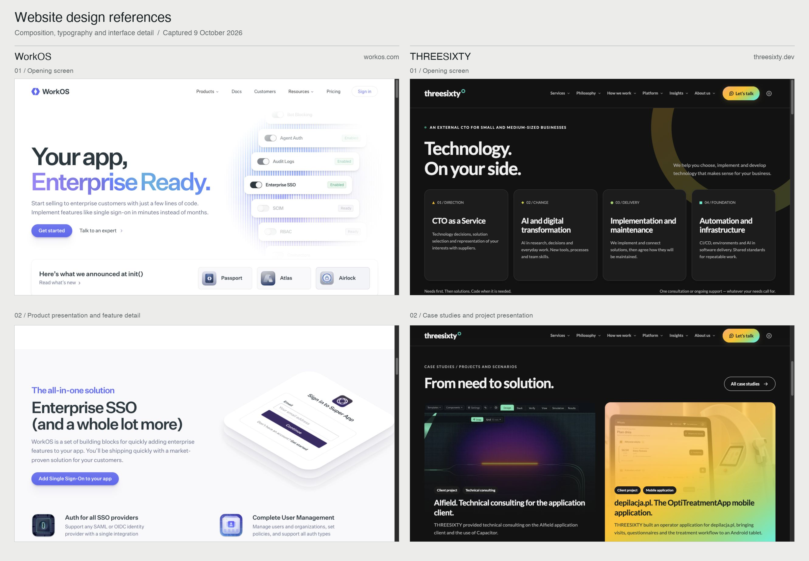

# Artifactory Established Mockup References

WorkOS and THREESIXTY are the established website design references for Artifactory. This set preserves the comparison board and four screenshots prepared on 9 October 2026, together with the user's selection and its scope. Use the captured examples to discuss composition, typography, hierarchy, and product presentation alongside the selected [Purple + Teal palette](../design-system/palette.json).

## Established Direction

In the project chat "Find fresh website design catalogs" on 9 October 2026, the user identified THREESIXTY as "much prettier," then asked for similar sites "not in the theme way." After reviewing the suggestions, the user said "ok work os seems fine" and requested screenshots as examples. WorkOS and THREESIXTY were retained together.

This establishes a visual reference pair. Artifactory's exact fonts, component geometry, layouts, motion, and any appearance switch remain undecided. The reference sites' brand colors and light/dark treatments do not replace the selected Artifactory colors.

## Reference Board

[Open the full-size board](../visuals/mockup-references/design-reference-board.png). Original size: 2662 x 1848 pixels.

## Individual Captures

The observations below describe visible qualities of the saved captures and give a focus for later design review. They are not new Artifactory layout decisions.

| Reference | Source website | Saved capture | Qualities to study |
| --- | --- | --- | --- |
| WorkOS opening screen | [WorkOS](https://workos.com/) | [workos-hero.jpg](../visuals/mockup-references/workos-hero.jpg) | Clear headline hierarchy, generous spacing, prominent action, and a composed interface illustration |
| WorkOS product section | [WorkOS](https://workos.com/) | [workos-product-section.jpg](../visuals/mockup-references/workos-product-section.jpg) | Technical content paired with a detailed product visual, followed by compact feature explanations |
| THREESIXTY opening screen | [THREESIXTY](https://threesixty.dev/) | [threesixty-hero.jpg](../visuals/mockup-references/threesixty-hero.jpg) | Large typography, deliberate section composition, concise service cards, and consistent spacing |
| THREESIXTY case studies | [THREESIXTY](https://threesixty.dev/) | [threesixty-case-studies.jpg](../visuals/mockup-references/threesixty-case-studies.jpg) | Substantial project imagery, clear labels, and a readable relationship between image and description |

Each individual capture is 1265 x 712 pixels. All five image files are unchanged copies of the earlier reference set; the live sites may subsequently differ.

## Use in the Artifactory Handoff

The references support later exploration of the company introduction, the two-project overview, and project detail presentation. Artifactory's investor-first purpose, proposed sitemap, bilingual content, and selected colors remain the controlling inputs.

Keep these images as external design references. They are not custom Artifactory mockups, public website content, or verified evidence of Artifactory product capabilities. In particular, the AIfield-labeled project image visible within THREESIXTY's case-study capture does not substitute for an approved AIFIELD interface asset. Required project visuals remain in the [input inventory](../required-items.md#visual-assets-still-missing).

## Provenance

Originating chat: "Find fresh website design catalogs", 9 October 2026. Chat ID: `01a121e0-8759-7602-869a-8e5066146b71`. The original screenshot board labels the capture date as 9 October 2026 and places WorkOS on the left and THREESIXTY on the right.

The [manifest](../manifest.json) records file hashes and origin metadata. The screenshots and notes are included in this portable package; the originating chat and live sites are not needed to inspect them. No research PDF or image extracted from a research PDF is included.
