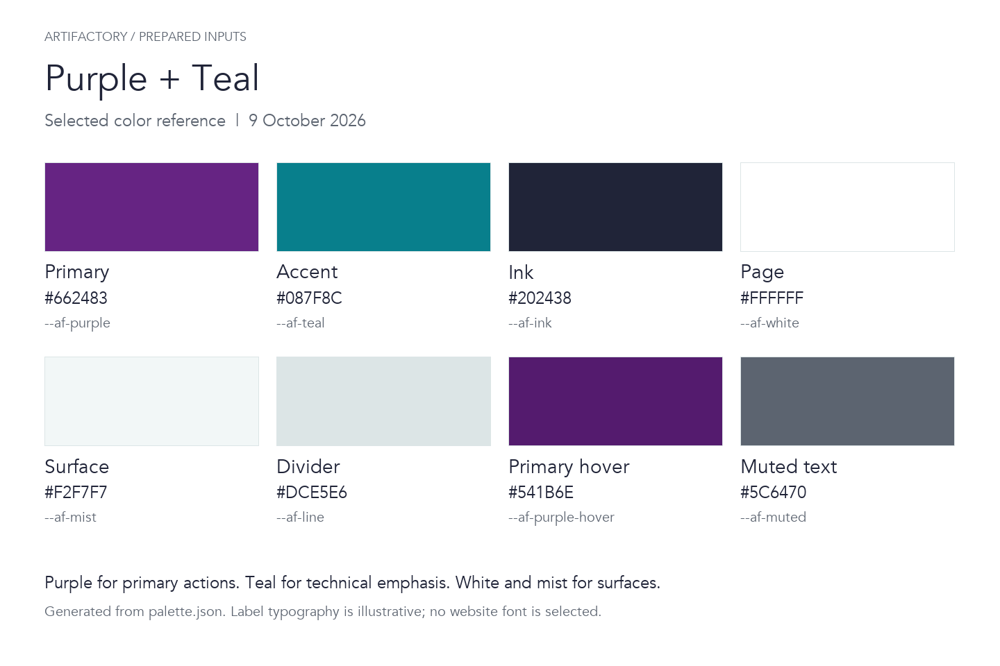

# Artifactory Prepared Website Inputs

Input package HP-1.1-inputs-only, based on the 9 October 2026 materials. This folder gathers the prepared requirements, project information, sitemap, colors, established mockup references, and asset requirements for the Artifactory website.

**Research PDFs are excluded.** Written project context is included so the package can be read without them. Historical source identifiers and page references in the planning records are provenance, not a requirement to supply those PDFs. No images have been extracted from them.

## Start Here

| Item | Contents | Status |
| --- | --- | --- |
| [Project brief](docs/project-brief.md) | Purpose, audience, objectives, selected capabilities, form requirements, and operating inputs | Prepared; open choices labeled |
| [Sitemap](docs/sitemap.md) | Seventeen proposed pages with English/Polish routes, project detail, navigation, and page briefs | Prepared proposal |
| [Decision register](docs/decision-register.md) | Confirmed decisions, proposals, dependencies, and owners | Prepared |
| [Project context](content/project-context.md) | Artifactory, ArtiSense, and AIFIELD background distilled into usable written notes | Prepared research summary; not approved final copy |
| [Required items checklist](required-items.md) | What is supplied, what is still missing, and which pages need the visuals | Prepared inventory |
| [Selected palette](design-system/palette.json) | Approved color direction, exact values, and usage | Supplied selected input |
| [Color tokens](design-system/colors.css) | Semantic CSS color variables | Supplied selected input |
| [Palette preview](visuals/palette-preview.png) | A visual reference generated from the selected palette | Generated reference, not a page mockup |
| [Established mockup references](references/mockup-references.md) | WorkOS and THREESIXTY comparison board, four screenshots, and the established direction | Supplied external design references |
| [File manifest](manifest.json) | Included files, origins, hashes, exclusions, and package status | Generated inventory |

## Confirmed Direction

- Investors first, partners second; the investment opportunity is Artifactory as a company.
- ArtiSense and AIFIELD, each with an overview and detailed subpages; other research deferred.
- English and Polish, with English as default.
- Contact form plus public email.
- Purple + Teal color direction from the supplied palette.
- WorkOS and THREESIXTY as visual references for composition, typography, hierarchy, and detailed product presentation.

The seventeen-page grouping and detailed routes remain proposals. Current business facts, final copy, asset approvals, technical stack, providers, and operational arrangements are not silently finalized by packaging them.

## Colors and Visuals

Use `design-system/palette.json` and `design-system/colors.css` for the selected colors. `design-system/sampled-colors.json` records earlier samples from the live site; its historical values and notes do not override the selected palette. The [SVG preview](visuals/palette-preview.svg) is also included.

### Established Mockup References

The [reference record](references/mockup-references.md) includes the four individual screenshots and preserves the user's direction to compare visual quality and composition, "not in the theme way." These existing captures were prepared on 9 October 2026. They inform later design without selecting either site's palette, theme, fonts, or exact layout for Artifactory.

Custom Artifactory page mockups and separate logo, product photograph/render, actual project interface screenshot, team portrait, technical diagram, and font files remain to be supplied or prepared. The checklist records their intended use. External reference screenshots are design inputs, not ready-to-publish Artifactory assets. The palette preview's label typography is illustrative and does not select a website font.

## Package Boundaries

This is a portable input snapshot. The project records retain the supplied website scope, content, design direction, proposals, and unresolved inputs. The color files are byte-for-byte copies of the supplied inputs. Future edits to the originals will not automatically update this snapshot.

HP-1.1 adds the established WorkOS and THREESIXTY references from the earlier design-reference chat. The board and four screenshots are byte-for-byte copies of those existing captures. Their origin and intended use are recorded in the reference notes and manifest.

The package contains no PDFs, source-deck extracts, website application, credentials, or deployment output.
